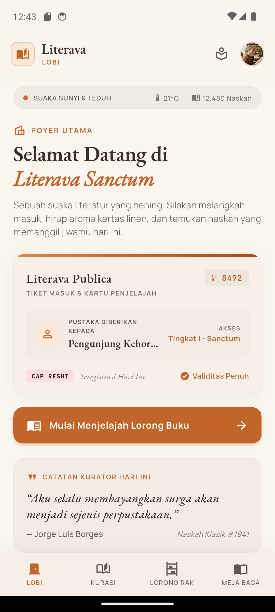
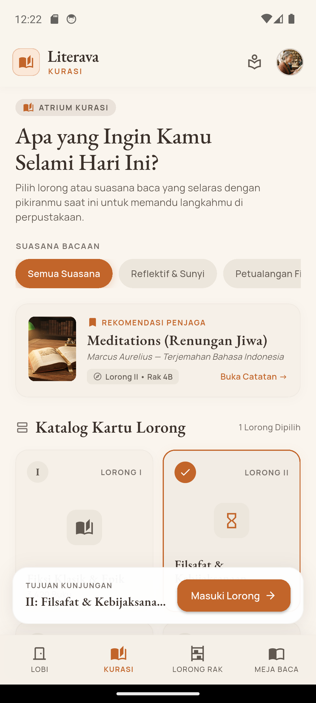
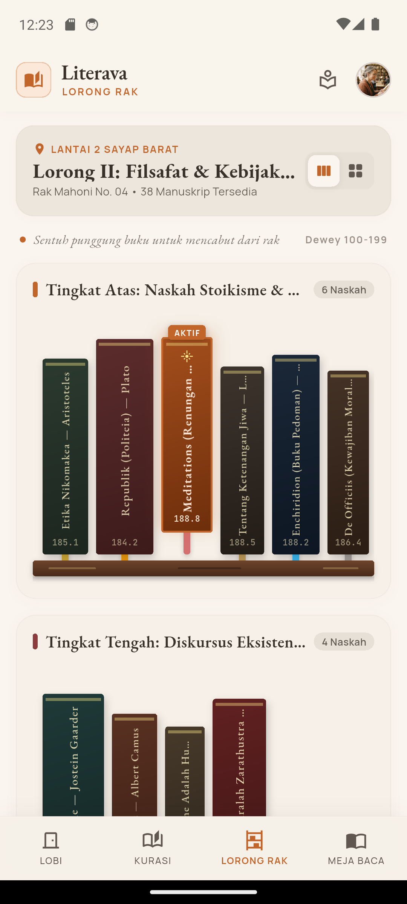
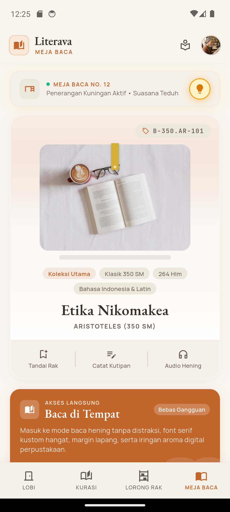
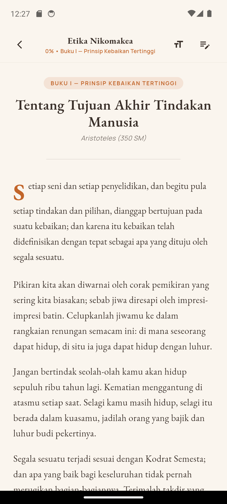

# Literava — Virtual Library & Warm Bookshelf Sanctum 🏛️📚

> **Tugas Proyek Pemrograman Mobile**  
> Framework: **Flutter 3.47 (Dart 3.7)**  
> Target Platform: **Android (API 34/35/36)** & Cross-Platform  
> Desain: **Sahara Warm Minimalism** (Terinspirasi dari *Stitch Virtual Library & Bookshelf*)  

---

## 📖 Tentang Literava

**Literava** adalah aplikasi perpustakaan virtual dan ruang baca digital yang dirancang dengan estetika **Sahara Warm Minimalism**. Aplikasi ini menghidupkan kembali kehangatan perpustakaan klasik Eropa abad ke-19 dengan sentuhan antarmuka modern (Bento Grid, micro-interactions, dan tipografi sastra).

Literava bukan sekadar katalog buku biasa; aplikasi ini memberikan pengalaman spasial yang membawa pengguna seolah-olah sedang melangkah masuk ke dalam suaka literatur yang tenang, memilih buku dari rak kayu walnut, dan membacanya di bawah temaram lampu meja bankir.

---

## ✨ Fitur Utama & Ruang Perpustakaan

Aplikasi terdiri dari **4 Ruang Utama (Tab Navigasi)** serta **1 Mode Pembaca Penuh (Immersive E-Reader)**:

### 1. 🏛️ Ruang Lobi Suaka (*Sanctum Lobby*)
- **Kartu Keanggotaan Digital Perpustakaan**: Menampilkan ID anggota unik, nomor arsip, stempel status "Aktif", dan chip perpustakaan bernuansa kuno.
- **Indikator Suasana (*Ambient Badge*)**: Informasi waktu suaka (*Pukul Suaka*), status kapasitas hening, dan sensor kenyamanan akustik dengan animasi denyut (*pulsing dot*).
- **Epigraf Harian Dinamis**: Kutipan filsafat dan sastra terpilih (Marcus Aurelius, Seneca, Rumi, Pramoedya Ananta Toer, dsb.) dengan tombol ganti kutipan secara interaktif.
- **Bento Grid Penjelajahan**: Akses instan menuju Kurasi Tematik, Lorong Rak Buku, dan Meja Baca.
- **Saklar Mode Hening (*Quiet Sanctuary Mode*)**: Mengaktifkan protokol keheningan suaka dengan notifikasi umpan balik khusus.

### 2. 🧭 Ruang Kurasi & Suasana Hati (*Mood Curation*)
- **Penyaring Suasana Hati (*Mood Filter Carousel*)**: Filter dinamis berdasarkan kondisi jiwa pembaca (*Semua, Meditatif, Melankolis, Pencerahan, Penjelajahan, Nostalgia*).
- **Sorotan Koleksi Utama (*Spotlight Collection*)**: Kartu pameran karya agung beriluminasi dengan rincian penerbit, tahun publikasi, dan tombol langsung baca.
- **Laci Genre Terbuka (*Genre Drawers*)**: Penjelajahan kategori buku klasik (Filsafat Stoik & Eksistensial, Sastra Abad ke-19, Arsip Sains & Kosmos, Catatan Ekspedisi) lengkap dengan status ketersediaan di lorong rak.
- **Bilah Kunjungan Cepat (*Sticky Quick-Visit Bar*)**: Navigasi cepat langsung menuju lorong rak terpilih.

### 3. 📚 Lorong Rak Kayu (*Interactive Bookshelf & Corridor*)
- **Visualisasi Rak Kayu Walnut (*Wooden Shelves*)**: Tampilan rak kayu berlapis aksen emas (*gold gilt trims*) dengan plakat kuningan penanda lorong.
- **Interaksi Penarikan Punggung Buku (*Book Spine Pulling*)**:
  - Sentuh buku apa pun di rak untuk menariknya ke depan secara visual (*elevation physics*).
  - Punggung buku berotasi vertikal menampilkan judul timbul, inisial emas, pita penanda (*reading ribbon*), dan kode panggil perpustakaan.
- **Kartu Inspeksi Buku Seketika**: Memunculkan rincian buku yang ditarik, nomor panggil Dewey Decimal, genre, dan tombol pindahkan ke Meja Baca.
- **Beralih Mode Tampilan**: Mendukung beralih antara tampilan **Rak Kayu Fisik** dan tampilan **Grid Matriks Arsip**.

### 4. 🕯️ Meja Baca & Lampu Bankir (*Reading Desk*)
- **Lampu Bankir Interaktif (*Interactive Banker's Lamp*)**:
  - Saklar lampu meja bergaya klasik hijau zamrud & kuningan.
  - Saat dinyalakan, meja baca memancarkan pendaran cahaya hangat (*golden ambient glow*) yang menerangi buku yang sedang terbuka.
  - Status saklar tersimpan secara permanen di memori lokal perangkat.
- **Pameran Buku Meja Baca (*Showcase Card*)**: Menampilkan buku aktif yang sedang dipelajari, bab terakhir, waktu estimasi baca, dan penanda favorit.
- **Bento Spesifikasi Fisik Buku**: Kartu detail format jilid (*Hardcover Linen / Clothbound*), penerbit, dimensi, dan tahun restorasi.
- **Bilah Aksi Meja (*Desk Actions Bar*)**: Akses instan untuk membuka Mode Pembaca Imersif.
- **Buku Catatan & Refleksi Marginalia**: Dialog catatan interaktif untuk menambah, membaca, dan menghapus kutipan pemikiran pribadi pembaca yang disimpan langsung ke database lokal.

### 5. 📖 Mode Pembaca Imersif (*Distraction-Free E-Reader*)
- **Bebas Gangguan**: Menghilangkan seluruh bilah navigasi untuk fokus membaca total.
- **Tipografi Sastra Klasik**: Menggunakan font serif **EB Garamond** dengan huruf awal berhias (*Drop Cap*) bernuansa manuskrip.
- **Tiga Tema Suasana Baca**:
  - 📜 *Linen Hangat* (Default - Lembut dan nyaman di mata di siang hari).
  - 🍂 *Kertas Sepia* (Nuansa kertas buku tua vintage).
  - 🌙 *Sanctum Gelap* (Nuansa malam bertabur bintang untuk membaca tanpa lelah).
- **Pengaturan Ukuran Teks Fleksibel**: Slider dinamis untuk menyesuaikan ukuran teks (14pt hingga 24pt).
- **Bilah Indikator Progres**: Pelacak kemajuan bab dan penanda bacaan (*Bookmark Toggle*).

### 6. 🔍 Pencarian Katalog Perpustakaan (*Global Catalog Search*)
- *Bottom Sheet Modal* yang dapat diakses dari ikon pencarian di bilah atas (*Header*).
- Pencarian instan berdasarkan judul buku, nama pengarang/filsuf, atau nomor panggil.

---

## 🎨 Sistem Desain: *Sahara Warm Minimalism*

Palet warna dan tipografi dirancang secara presisi mengacu pada prinsip minimalisme hangat:

| Elemen | Kode Hex | Deskripsi |
| :--- | :--- | :--- |
| **Primary (Burnt Sienna)** | `#C2652A` | Warna tanah liat hangat khas terakota & gurun Sahara |
| **Primary Container** | `#FFDBC9` | Warna aksen lembut untuk seleksi & kontainer aktif |
| **Secondary (Warm Linen)** | `#FAF5EE` | Latar belakang utama bernuansa serat kertas linen kuno |
| **Surface Container Low** | `#F5EFE6` | Permukaan kartu dan bento sekunder |
| **Surface Container High**| `#E9E0D4` | Kontur pemisah dan pil filter |
| **On Surface (Espresso)** | `#3A302A` | Teks utama bertinta cokelat pekat ramah mata |
| **Warm Accent (Dusty Rose)**| `#8C3C3C` | Aksen stempel perpustakaan & bookmark |
| **Deep Wood (Walnut)** | `#492B1A` / `#6E432A` | Punggung buku kulit dan kayu rak |

### Pasangan Tipografi (*Font Pairing*)
- **Heading & Judul Sastra**: `EB Garamond` (Google Fonts) — Serif klasik nan anggun untuk membangkitkan suasana naskah sastra klasik.
- **Antarmuka & Label**: `Manrope` (Google Fonts) — Sans-serif geometris modern dengan keterbacaan tinggi pada layar ponsel pintar.

---

## 🏗️ Struktur Arsitektur Proyek

Proyek ini menerapkan arsitektur bersih berbasis pola **MVVM (Model - View - ViewModel / Provider)**:

```
literava/
├── android/                   # Konfigurasi native Android (Gradle, Manifest, SDK)
├── assets/                    # Gambar & aset statis
├── lib/
│   ├── main.dart              # Entry point aplikasi & konfigurasi SystemChrome
│   ├── core/
│   │   └── theme/
│   │       ├── app_colors.dart        # Definisi palet warna Sahara Warm
│   │       ├── app_typography.dart    # Definisi gaya teks EB Garamond & Manrope
│   │       └── app_theme.dart         # Konfigurasi ThemeData Material 3
│   ├── models/
│   │   ├── book.dart                  # Model data buku, nomor panggil, warna spine, kutipan
│   │   ├── genre_lane.dart            # Model data lorong genre rak
│   │   └── book_note.dart             # Model data catatan refleksi pembaca (JSON serializable)
│   ├── services/
│   │   ├── library_service.dart       # Katalog buku kurasi & repositori kutipan
│   │   └── storage_service.dart       # Layanan persistensi lokal via SharedPreferences
│   ├── providers/
│   │   └── library_provider.dart      # Central State Management (ChangeNotifier)
│   ├── screens/
│   │   ├── main_screen.dart           # Shell navigasi utama 4 tab (IndexedStack)
│   │   ├── lobi/                      # Ruang 1: Lobi Suaka
│   │   │   ├── lobi_screen.dart
│   │   │   └── widgets/ (ambient_badge, library_card_slip, epigraph_card, discovery_bento)
│   │   ├── kurasi/                    # Ruang 2: Kurasi & Suasana Hati
│   │   │   ├── kurasi_screen.dart
│   │   │   └── widgets/ (mood_filter_pills, spotlight_card, genre_drawer_card)
│   │   ├── lorong_rak/                # Ruang 3: Lorong Rak Kayu
│   │   │   ├── lorong_rak_screen.dart
│   │   │   └── widgets/ (wooden_shelf, book_spine, book_inspect_card, book_grid_card)
│   │   ├── meja_baca/                 # Ruang 4: Meja Baca & Lampu Bankir
│   │   │   ├── meja_baca_screen.dart
│   │   │   ├── dialogs/ (notes_dialog.dart)
│   │   │   └── widgets/ (bankers_lamp_glow, book_showcase_card, desk_actions_bar, specs_bento, chapter_preview_card)
│   │   └── reader/                    # Ruang 5: Mode Pembaca Penuh
│   │       └── reader_screen.dart
│   ├── catalog/
│   │   └── search_catalog_sheet.dart  # Modal pencarian katalog global
│   └── widgets/
│       ├── app_header.dart            # Bilah atas aplikasi bernuansa linen
│       └── custom_toast.dart          # Komponen notifikasi mengambang
└── test/
    ├── widget_test.dart               # Pengujian render smoke test
    └── navigation_test.dart           # Pengujian komprehensif alur navigasi 4 tab & reader
```

---

## 🧪 Hasil Pengujian & Verifikasi Kualitas

Aplikasi telah melalui serangkaian pengujian otomatis dan verifikasi build:

1. **Analisis Kode Statis (`flutter analyze`)**:
   ```
   Analyzing literava...
   No issues found! (ran in 3.0s)
   ```
   *100% Bebas kesalahan, nol peringatan, dan patuh pada kaidah Dart 3.7 & Flutter 3.47.*

2. **Pengujian Unit & Widget (`flutter test`)**:
   ```
   00:03 +2: All tests passed!
   ```
   *Semua skenario navigasi antar layar, pergantian tab, dan pembukaan reader terverifikasi lulus.*

3. **Verifikasi Build Debug APK**:
   ```
   ✓ Built build\app\outputs\flutter-apk\app-debug.apk (169MB)
   ```

4. **Verifikasi Live Emulator (Android 14 / Pixel 6)**:
   Aplikasi telah dijalankan langsung pada emulator `Pixel_Codex` dengan verifikasi visual responsif pada resolusi 1080x2400.

---

## 📸 Galeri Tangkapan Layar (Screenshots)

| 1. Lobi Suaka | 2. Kurasi Suasana | 3. Lorong Rak Kayu |
| :---: | :---: | :---: |
|  |  |  |

| 4. Tarik Punggung Buku | 5. Meja Baca & Lampu Bankir | 6. Pembaca Imersif |
| :---: | :---: | :---: |
|  |  |  |

---

## 🚀 Panduan Menjalankan Aplikasi

Pastikan perangkat Android atau Emulator sudah terhubung:

### 1. Masuk ke direktori proyek
```bash
cd "D:\Project Pemrograman Mobile\literava"
```

### 2. Jalankan di Android Emulator / Perangkat Fisik
```bash
flutter run
```

### 3. Build APK Baru (Jika Diperlukan)
```bash
flutter build apk --debug
```
File APK siap instal akan berada di:
`build/app/outputs/flutter-apk/app-debug.apk`

---

## 📦 Dependensi Utama

- `flutter`: SDK Framework
- `provider`: `^6.1.5+1` (State Management terstruktur)
- `google_fonts`: `^9.0.0` (Tipografi sastra EB Garamond & Manrope)
- `shared_preferences`: `^2.5.6` (Penyimpanan persisten lokal untuk preferensi pembaca)
- `intl`: `^0.20.3` (Format penanggalan catatan marginalia)

---
*Dibuat dengan penuh dedikasi untuk Tugas Mata Kuliah Pemrograman Mobile.*
